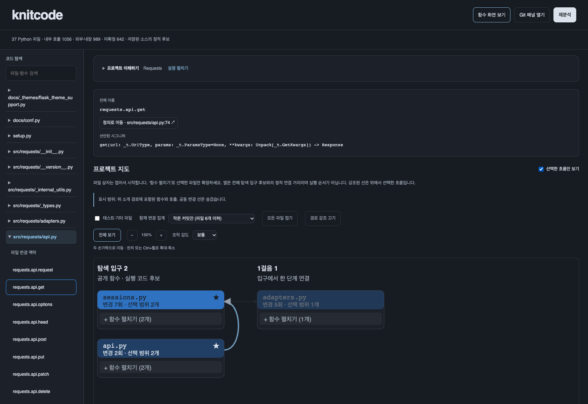

# knitcode 0.4.12

처음 보는 Python 프로젝트의 구조와 함수 호출 관계, Git 변경 맥락을 탐색하는 VS Code 확장입니다. 분석할 프로젝트를 열고 **`knitcode: Open Call Flow`**를 실행하세요.

- **[화면과 함께 보는 팀원 사용 안내](USER_GUIDE_KO.md)** — 설치, 전체 기능, 조작법, 결과 해석, 검증 순서
- **[개발 안내](VISUALIZATION_KO.md)** — 코드 구조, 데이터 계약, 테스트, 다음 과제
- **[0.4.12 설치 파일](../releases/knitcode-0.4.12/knitcode-static-0.4.12.vsix)** — GitHub에서 Download raw file로 다운로드



## 포함 기능

| 화면 | 주요 기능 |
|---|---|
| 프로젝트 이해하기 | README 소개, 탐색 후보와 선정 근거, 호출 한 갈래, 설명 접기 |
| 프로젝트 지도 | 파일·함수 상자, 펼치기·접기, 선택 흐름 필터, 경로 강조 |
| 파일·함수 탐색 | 파일 그래프, 호출자·호출 대상 1~3단계, 전체 이름·시그니처, 소스 이동 |
| 호출 근거 | 호출 위치·규칙, 인자와 매개변수 대응, 외부·미확정 호출 구분 |
| Git 변경 맥락 | 공동 변경, 커밋 diff, 작성자별 함수 핫스팟, 미커밋 변경 영향 후보, HTML 보고서 |
| 조작·배치 | 트랙패드 이동·핀치, 감도 선택, 전체 보기, 선택 위치·스크롤 유지, 패널 접기·너비 조절 |

## 시작하기

VS Code 1.85 이상, Python 3.10 이상이 필요합니다. Git 기능은 Git과 로컬 커밋 이력이 필요합니다. 확장을 쓰기 위한 추가 Python 패키지 설치는 없습니다.

1. VS Code 확장 화면의 `… → Install from VSIX...`로 설치합니다.
2. 기존 버전이었다면 `Developer: Reload Window`를 실행합니다.
3. 신뢰한 로컬 Python 프로젝트 폴더를 엽니다. Git 기능은 저장소 최상위 폴더에서 사용합니다.
4. 명령 팔레트에서 `knitcode: Open Call Flow`를 실행합니다.

Python 오류가 나면 설정의 `knitcodeStatic.pythonPath`를 Python 3.10 이상 실행 파일로 지정하세요. 기존 확장 ID `knitcode-local.knitcode-static`과 설정을 유지합니다.

## 개발 실행과 패키징

저장소 루트에서 실행합니다.

```bash
code --extensionDevelopmentPath="$PWD/vscode-extension" /path/to/python-project
python3 scripts/package_extension.py
python3 -m unittest discover -s tests
```

설치 파일은 `dist/knitcode-static-0.4.12.vsix`에 생성됩니다. 재분석은 저장된 소스를 기준으로 합니다.

탐색 시작점과 연결은 정적 분석 후보입니다. 실제 실행·전체 호출 관계·타입 적합성을 증명하지 않습니다. 공동 변경은 관측된 Git 이력이며 코드 의존성이나 인과관계를 뜻하지 않습니다. 자세한 해석 범위는 [사용 안내 8장](USER_GUIDE_KO.md#8-설정과-해석할-때의-주의점)을 참고하세요.
