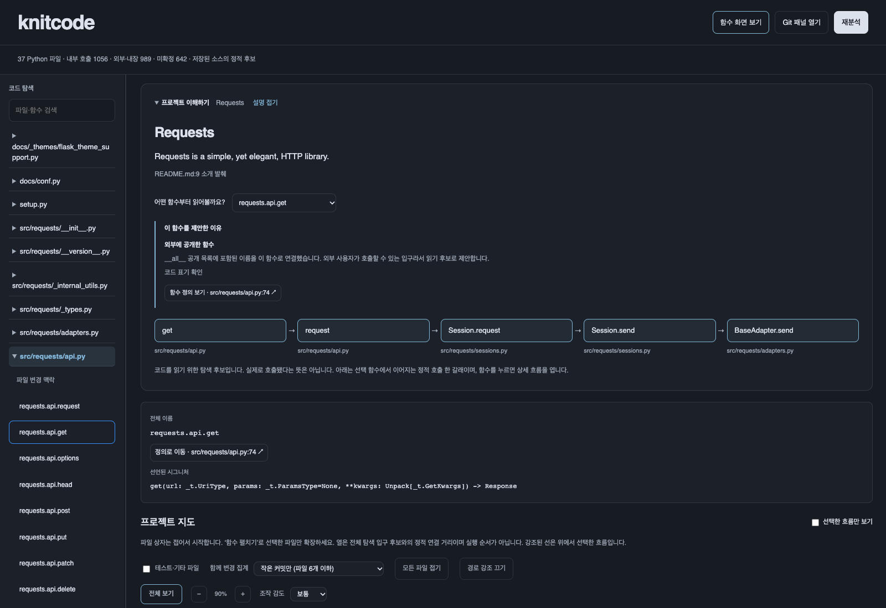
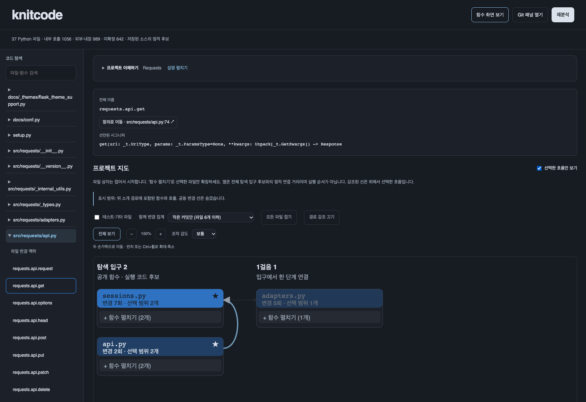
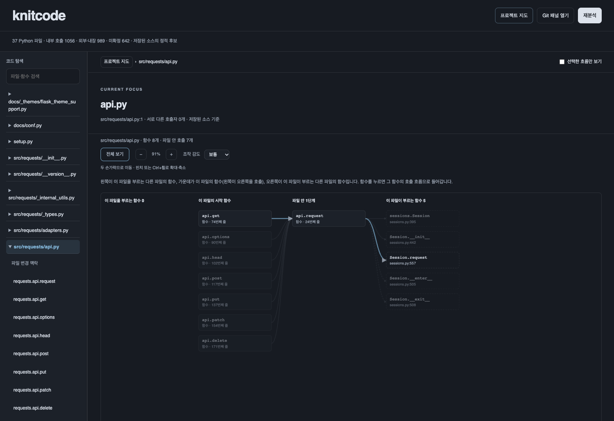
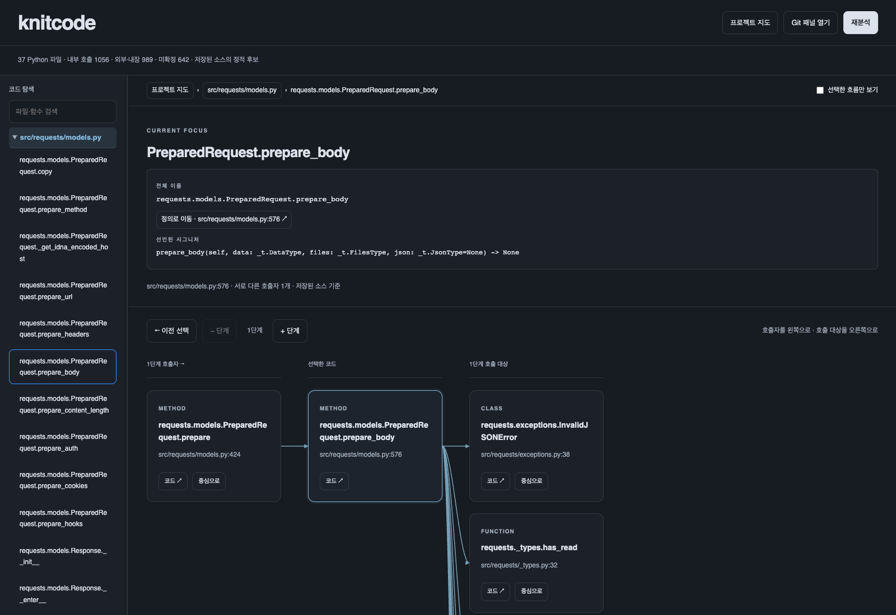
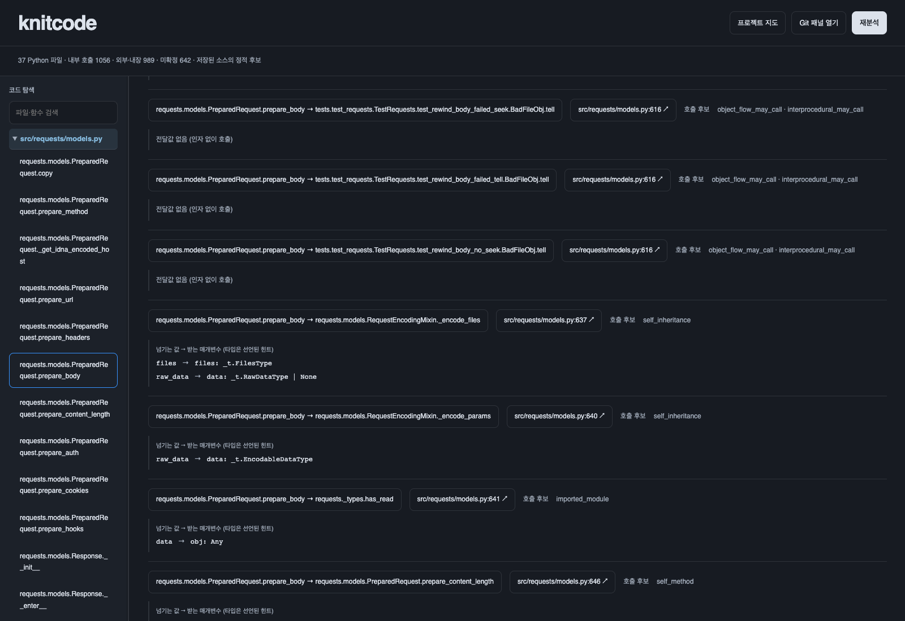
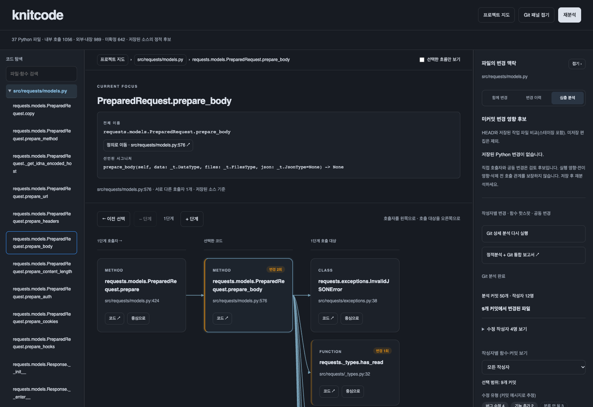

# knitcode 0.4.12 — 시각화 사용 안내

처음 보는 Python 프로젝트의 소개와 구조를 살펴보고, 함수 호출 관계와 Git 변경 이력을 따라 읽는 VS Code 확장입니다. 대상 코드를 실행하지 않고 저장된 소스와 로컬 Git 기록을 분석합니다.

**권장 순서:** 프로젝트 이해하기 → 프로젝트 지도 → 파일 그래프 → 함수 호출 흐름 → Git 변경 맥락.

## 1. 설치하고 실행하기

필요 환경은 VS Code 1.85 이상, Python 3.10 이상입니다. Git 변경 기능을 사용하려면 Git과 커밋 이력이 있는 저장소가 필요합니다. 사용을 위한 추가 Python 패키지 설치는 없습니다.

1. [0.4.12 설치 파일](../releases/knitcode-0.4.12/knitcode-static-0.4.12.vsix)을 열고 GitHub의 **Download raw file**로 다운로드합니다.
2. VS Code 확장 화면에서 `… → Install from VSIX...`로 설치합니다.
3. 기존 버전이 있었다면 명령 팔레트에서 `Developer: Reload Window`를 실행합니다.
4. 분석할 Python 프로젝트의 최상위 폴더를 열고 프로젝트를 신뢰합니다. Git 정보를 보려면 Git 저장소 최상위 폴더를 여세요.
5. macOS는 `Cmd+Shift+P`, Windows/Linux는 `Ctrl+Shift+P`를 누르고 **`knitcode: Open Call Flow`**를 실행합니다.

기본 Python 명령은 macOS/Linux에서 `python3`, Windows에서 `python`입니다. 실행 오류가 나면 VS Code 설정의 `knitcodeStatic.pythonPath`에 Python 3.10 이상 실행 파일 경로를 지정하세요.

## 2. 지금 포함된 기능

| 영역 | 할 수 있는 일 |
|---|---|
| 프로젝트 이해하기 | README 소개와 출처 확인, 탐색 시작점 선택, 후보 선정 이유 확인, 최대 5개 함수의 호출 한 갈래 탐색 |
| 프로젝트 지도 | 파일별 함수 상자, 정적 연결 거리별 배치, 파일별 펼치기·접기, 호출·공동 변경 관계 탐색 |
| 지도 조작 | 두 손가락 이동, 핀치 확대·축소, 배율 확인, 전체 보기, 감도 선택 |
| 선택 범위 | 경로 강조 켜기·끄기, 선택한 흐름만 보기, 전체 연결 복원 |
| 파일 그래프 | 파일 안 함수와 외부 파일 함수의 연결 확인, 함수 선택 |
| 함수 호출 흐름 | 호출자·호출 대상 1~3단계 확장, 이전 선택으로 돌아가기 |
| 함수 정보 | 전체 이름, 파일과 줄, 선언된 시그니처, 정의 위치 이동 |
| 호출 근거 | 호출 위치·분석 규칙, 전달 인자와 매개변수 대응, 외부·내장·미확정 호출 구분 |
| 왼쪽 코드 탐색 | 파일·함수 검색, 선택 함수의 파란 테두리, 스크롤 중 파일명 유지 |
| Git 패널 | 함께 변경, 커밋 diff, 작성자별 함수 핫스팟, 수정 유형, 미커밋 변경 영향 후보 |
| 보고서 | 같은 커밋의 정적 분석과 Git 이력을 결합한 HTML 보고서 생성 |

## 3. 프로젝트 이해하기: 어디부터 읽을까?



README에서 소개를 발췌하고 원문 파일·줄을 표시합니다. 소개를 찾지 못하면 목적을 임의로 생성하지 않고 안내합니다.

`어떤 함수부터 읽어볼까요?` 메뉴는 **실제 실행 시작점**을 확정하는 메뉴가 아닙니다. 프로그램을 이해하기 위해 코드를 읽기 시작할 후보를 고르는 메뉴입니다.

| 후보 분류 | 제안하는 이유 |
|---|---|
| 직접 실행 코드 | `__main__.py` 또는 `if __name__ == "__main__"` 안에서 호출한 함수 |
| 외부에 공개한 함수 | `__all__` 공개 목록의 이름과 연결한 함수 |
| 패키지에서 노출한 함수 후보 | `__init__.py`가 비공개 이름이 아닌 이름으로 가져오는 함수 |
| 설치된 명령의 연결 대상 | 패키지 설정에서 실행 명령과 연결한 함수 |
| 명령·웹 요청·웹 이벤트·작업 등록 후보 | 해당 프레임워크의 등록 구문을 근거로 추정한 함수 |

선택하면 `이 함수를 제안한 이유`와 코드 표기 확인/정적 추정 여부를 보여줍니다. 공개 함수는 다른 코드가 호출할 수 있는 입구여서 후보가 되지만, 실제 호출됐다는 뜻은 아닙니다.

아래 화살표는 확인된 일반 호출 중 **한 갈래**입니다. 최대 5개 함수만 표시하며 생성자와 특수 메서드는 소개 경로에서 제외합니다. 함수 이름을 누르면 상세 화면으로 이동합니다. 현재 정책은 같은 이름으로 이어지는 호출, 공개 이름, 후속 호출 수를 우선하며 전체 기능이나 데이터의 입출력을 요약한 결과는 아닙니다.

설명은 처음에는 펼쳐집니다. 파일·함수 탐색 또는 파일 상자 펼치기를 시작하면 접히며, `프로젝트 이해하기`를 눌러 다시 펼칠 수 있습니다.

## 4. 프로젝트 지도: 전체 구조와 필요한 연결 보기



- **상자:** 파일. 처음에는 접힌 상태입니다. 머리의 파일명을 누르면 파일 그래프가 열립니다.
- **함수 펼치기:** 해당 파일의 호출 관계가 있는 함수·메서드·클래스를 표시합니다. 미연결 항목은 파일 화면에서 확인할 수 있습니다.
- **모든 파일 접기:** 펼친 상자를 접습니다. 본문 스크롤 위치는 유지합니다.
- **열:** 분석기가 찾은 전체 탐색 입구 후보와의 정적 연결 거리입니다. 소개에서 고른 함수만을 기준으로 다시 계산한 열이나 실제 실행 순서는 아닙니다.
- **파일 머리의 파랑 농도:** 파일 변경 횟수. **주황 테두리·변경 횟수:** 함수 변경 정보. 함수 변경 정보는 Git 심층 분석이 끝난 뒤 반영됩니다.
- **회색 계열 화살표:** 호출 관계. **주황 파선/점선:** 반복된 공동 변경 관계입니다. 확대 시 함수 수준, 축소 시 파일 수준으로 표시합니다.

`경로 강조 끄기/켜기`는 선택한 관계를 밝게 표시하는 효과만 바꿉니다. 선택 함수나 필터 범위는 바뀌지 않습니다. 마우스를 함수 위에 올리면 주변 두 단계 이내 연결을 일시적으로 강조합니다.

`선택한 흐름만 보기`는 흐리게 만드는 대신 관련 없는 파일·함수·연결을 숨깁니다. 소개 경로에 있는 함수를 보고 있다면 그 경로를, 소개 경로 밖의 함수를 선택했다면 해당 함수의 두 단계 이내 주변 연결을 표시합니다. 공동 변경 선은 숨깁니다. 체크를 해제하면 전체 범위로 돌아갑니다.

### 지도와 파일 그래프 조작

| 입력/버튼 | 동작 |
|---|---|
| 트랙패드 두 손가락 스크롤 | 지도 이동 |
| 핀치 또는 Ctrl+휠 | 커서 위치를 중심으로 확대·축소 |
| 마우스로 빈 공간 드래그 | 지도 이동 |
| `− / +` | 일정 비율로 축소·확대 |
| `전체 보기` | 위치·배율을 초기화하고 지도 전체를 화면에 맞춤 |
| `조작 감도` | 느리게·보통·빠르게. 지도와 파일 그래프가 같은 설정 사용 |
| 파일·함수에 Tab 후 Enter/Space | 해당 항목 선택 |

## 5. 파일 그래프: 파일 안의 함수 관계 보기



파일명을 선택하면 가운데에 그 파일의 함수들이, 양옆에 이 파일을 호출하거나 이 파일에서 호출하는 다른 파일의 함수들이 나타납니다. 외부 파일 함수는 점선 테두리와 파일명으로 구분합니다.

테스트 호출자는 그림에서 분리해 개수를 안내하며, 양옆의 외부 함수는 연결 수를 기준으로 각각 최대 12개를 보여줍니다. 호출 관계가 확인되지 않은 항목은 아래 접힌 목록에서 볼 수 있습니다. 함수나 클래스를 누르면 해당 항목의 호출 흐름으로 들어갑니다.

화면의 왼쪽→오른쪽 배치는 정적 호출 관계를 읽기 위한 배치입니다. 실제 실행 시간 순서는 아닙니다.

## 6. 함수 화면: 전체 이름, 호출 관계, 전달값



선택한 함수의 전체 이름, 파일·줄, 선언된 시그니처를 확인합니다. `정의로 이동` 또는 카드의 `코드 ↗`로 소스를 엽니다. 시그니처가 없으면 없다고 표시하며 임의로 채우지 않습니다.

- 가운데는 선택 함수, 왼쪽은 호출자, 오른쪽은 호출 대상입니다.
- `+ 단계 / − 단계`로 1~3단계를 탐색합니다. 단계가 바뀌어도 선택 카드의 가로 위치를 유지합니다.
- `이전 선택`으로 앞서 선택한 항목으로 돌아갑니다.
- 탐색 경로 `프로젝트 지도 › 파일 › 함수`에서 지도·파일로 돌아갈 수 있습니다. 함수 간 호출 경로와는 다른, 현재 화면의 위치 표시입니다.
- 왼쪽 목록의 선택 함수는 배경색·배지 없이 파란 테두리로 표시합니다. 선택이 바뀌면 해당 항목을 목록 안에서 보여줍니다. 검색창과 펼친 파일명은 목록을 스크롤해도 확인할 수 있습니다.



아래 근거 영역에서 호출 위치, 분석 규칙, 내부 호출 후보와 외부·내장·미확정 호출을 구분합니다. `넘기는 값 → 받는 매개변수`는 호출 원문과 함수 선언을 짝지은 결과입니다. 예를 들어 `raw_data → data: _t.RawDataType | None`처럼 표시합니다.

타입은 **선언된 힌트**이며 실제 런타임 값의 타입 검사 결과가 아닙니다. `*args`, `**kwargs`처럼 펼쳐 넘기면 대응이 불확실하다고 표시합니다. 시그니처나 원문이 없으면 대응하지 못할 수 있습니다.

## 7. Git 패널: 변경 맥락 보기



지도에서는 Git 패널이 기본으로 접힙니다. 상단 `Git 패널 열기`로 열고 패널 제목 옆 `접기 ›`로 닫습니다. 경계선을 드래그하거나 키보드로 너비를 조절할 수 있습니다.

| 탭 | 표시 내용 |
|---|---|
| 함께 변경 | 선택 파일과 2회 이상 같은 커밋에서 바뀐 현재 Python 파일, 공동 변경 커밋 |
| 변경 이력 | 선택 파일의 커밋 목록. 커밋 선택 시 VS Code diff 열기 |
| 심층 분석 | 작성자별 함수·커밋 필터, 함수 핫스팟 막대 차트, 커밋 메시지 기반 수정 유형, 공동 변경 정보 |

심층 분석의 함수 핫스팟은 현재 코드에서 함수 위치가 유일하게 확인될 때 호출 흐름과 소스로 연결합니다. 작성자 필터는 함수·커밋 목록에 적용하며 파일 전체 통계·공동 변경은 전체 작성자 기준입니다. 작성자 표시는 Git 메타데이터의 이메일 기준이며 GitHub 계정 인증 결과가 아닙니다.

### 저장한 변경을 검토하기

1. Python 소스를 수정하고 **저장**합니다.
2. 상단 `재분석`을 누릅니다.
3. `심층 분석 → 미커밋 변경 영향 후보`에서 추가·수정·삭제 함수, 현재 그래프의 직접 호출자, 함께 변경된 파일을 확인합니다.

기준은 HEAD 대비 저장된 작업 파일입니다. 스테이징·미스테이징·추적되지 않은 Python 파일을 포함하며 미저장 편집과 Git이 무시하는 새 파일은 제외합니다. 최대 200개 변경 파일, 파일별 500KB 제한이 있고 제외 사유를 표시합니다. 주석·공백만 바뀐 경우 함수 AST 변경으로 집계하지 않습니다. 삭제·이름 변경 함수의 이전 호출 관계는 현재 그래프에서 복원하지 않습니다.

`Git 상세 분석 다시 실행`은 과거 이력만 갱신합니다. 현재 소스 변경을 반영하려면 `재분석`을 사용하세요.

`정적분석 + Git 통합 보고서 ↗`는 같은 커밋의 코드·이력을 분석한 HTML을 브라우저에서 엽니다. 이 보고서는 커밋된 소스 기준이며 미커밋 변경은 포함하지 않습니다.

## 8. 설정과 해석할 때의 주의점

| VS Code 설정 | 기본값 | 의미 |
|---|---|---|
| `knitcodeStatic.pythonPath` | 자동 | 분석에 사용할 Python 실행 파일 |
| `knitcodeStatic.historyDays` | 90 | 기본 Git 이력 기간(일) |
| `knitcodeStatic.commitLimit` | 300 | 기본 Git 이력 최대 비병합 커밋 수 |
| `knitcodeStatic.gitValidationAutoRun` | true | 정적 분석 후 Git 심층 분석 자동 실행 |
| `knitcodeStatic.gitValidationCommitLimit` | 50 | Git 심층 분석 커밋 상한 |

- 정적 호출 후보는 실제 실행·전체 호출 관계·실행 순서의 증명이 아닙니다. 동적 생성 코드나 런타임 설정에 따라 누락·추정이 있을 수 있습니다.
- 탐색 후보의 `코드 표기 확인`은 선언·등록 근거를 찾았다는 뜻이며 실행됐다는 뜻은 아닙니다.
- Git 공동 변경은 함께 검토할 단서이며 호출 관계나 인과관계를 뜻하지 않습니다.
- 지도 공동 변경 집계 기본값은 파일 6개 이하 커밋, Git 탭은 50개 이하 커밋입니다. 지도에서 50개 기준으로 바꿀 수 있습니다.
- Git은 로컬 이력을 사용합니다. 원격 자동 fetch나 GitHub PR·Issue·CI 조회는 이 화면에 연결돼 있지 않습니다. Git이 없어도 코드 탐색은 사용할 수 있습니다.
- 선택한 코드의 자연어 설명 생성, 실제 동적 추적, 타입 적합성 검사는 현재 기능에 포함되지 않습니다. README 소개는 원문 발췌입니다.

## 9. 팀원이 확인할 순서와 검증 범위

예제는 공식 [psf/requests](https://github.com/psf/requests)입니다. 팀원의 로컬 경로는 각자 다르므로 아래와 같이 별도 위치에 받으세요.

```bash
git clone https://github.com/psf/requests.git ../requests
code --extensionDevelopmentPath="$PWD/vscode-extension" ../requests
```

이 저장소 루트에서 명령을 실행합니다. Windows PowerShell에서는 `$PWD` 대신 확장 폴더의 실제 절대 경로를 사용해도 됩니다.

1. `get`을 탐색 시작점으로 고르고 공개 함수 후보가 된 이유를 확인합니다.
2. 설명을 접고 `선택한 흐름만 보기`를 켜 파일·연결이 줄어드는지 봅니다.
3. 파일을 펼치고 함수 선택 시 왼쪽 테두리·파일명과 전체 함수 정보가 맞는지 봅니다.
4. 호출 단계를 1→2→3→2→1로 바꿔 선택 카드가 유지되는지 봅니다.
5. 전체 접기, 경로 강조, 감도 변경과 `전체 보기`를 확인합니다.
6. Git 패널에서 변경 이력·핫스팟과 코드 이동을 확인합니다.

**검증:** macOS / Python 3.12에서 `python -m unittest discover -s tests -v` 212개 통과. Mac JavaScriptCore 화면 동작 테스트를 포함합니다. 지도·파일·함수 이동, 전달값, 필터, 스크롤 유지, 감도와 반응형 배치는 실제 Webview HTML/CSS/JS를 Chrome에서 별도로 검증했습니다. 실제 VS Code 내부의 설치·테마별 클릭 검증은 팀 환경에서 추가 확인해야 합니다.

이 문서의 이미지는 requests `3c7baaa`를 분석한 Webview의 Chrome 미리보기입니다. VS Code 테마·창 너비·저장소 버전·Git 관측 범위에 따라 모양과 수치가 달라집니다. 이미지에는 공개 예제 소스만 사용했습니다.

개발 구조와 다음 과제는 [개발 안내](VISUALIZATION_KO.md)를 참고하세요.
